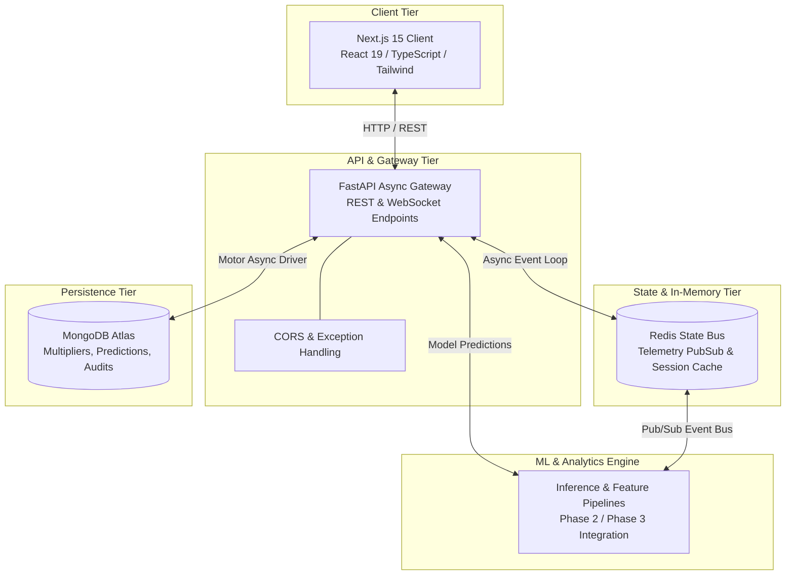

# CRASHSENSE AI - Technical Architecture

## 1. System Overview

CRASHSENSE AI is an institutional-grade predictive analytics and telemetry monitoring engine for high-frequency multiplier crash dynamics. The system employs asynchronous pipelines, event-driven websockets, machine learning inference layers, and risk engine guardrails.

---

## 2. Component Responsibilities

### Frontend (`/frontend`)
- **Framework**: Next.js 15 App Router, React 19, TypeScript strict mode.
- **Styling**: Tailwind CSS with custom neon/navy design token system.
- **Role**: Renders telemetry dashboards, real-time odds charts, risk guardrails, and audit logs.
- **Resilience**: Integrated root loading state (`loading.tsx`), graceful error boundary (`error.tsx`), and 404 page (`not-found.tsx`).

### Backend Gateway (`/backend`)
- **Framework**: FastAPI, Python 3.13, Pydantic v2.
- **Role**: Handles telemetry ingestion, authentication, prediction delivery, and system health checks.
- **Concurrency**: Asynchronous non-blocking architecture using `asyncio`, Motor, and `redis.asyncio`.
- **Security**: Strict CORS domain whitelist, non-root container deployment, sanitized diagnostics without credential leaks.

### State & Storage
- **Redis**: High-throughput in-memory pub/sub and ephemeral state cache.
- **MongoDB Atlas**: Sharded document persistence for round telemetry, predictions, and immutable audit logs.

### ML Subsystem (`/ml`)
- Pre-allocated directories for feature engineering, model training, evaluation, and serialized checkpoints in later phases.

