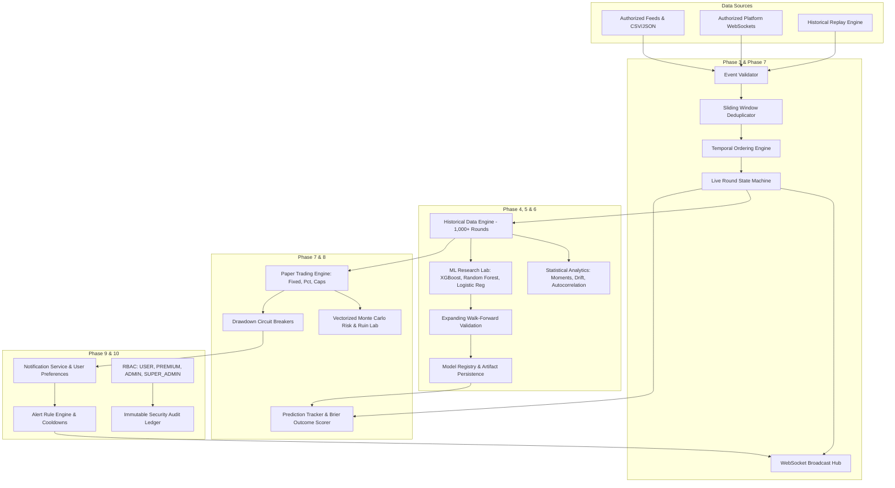

# CRASHSENSE AI — Final Project Architecture & Production System Blueprint

## 1. Executive System Summary

CRASHSENSE AI is a production-grade multi-platform crash-game analytics, statistical research, machine learning experimentation, and paper-trading simulation SaaS platform.

### Core System Invariants & Ethical Boundaries:
1. **Pure Virtual Simulation**: Real-money betting, automated wagering, deposit/withdrawal integration, or unattended betting bots are **strictly prohibited**.
2. **Zero Lookahead Bias**: In all ML feature construction and backtesting logic, decisions at round $t$ are computed strictly prior to observing round $t$'s outcome.
3. **Strict Baseline Comparisons**: Machine learning models and strategies are benchmarked against theoretical CSPRNG memoryless null baselines ($P(M \ge m) = \frac{1-h}{m}$) and historical base rate frequencies. Models failing to prove an edge are rejected.
4. **Data Isolation**: Raw telemetry feeds, normalized rounds, statistical metrics, ML artifacts, research estimates, and virtual simulation trades remain strictly partitioned.

---

## 2. End-to-End System Architecture



---

## 3. Technology Stack & Directory Layout

- **Frontend**: Next.js 15 (App Router), React 19, TypeScript, Tailwind CSS, Lucide icons.
- **Backend**: Python 3.11+, FastAPI (Async), Pydantic v2, Scikit-learn, XGBoost, Joblib, Scipy, Numpy, Pandas.
- **Database & Messaging**: MongoDB (Motor async driver), Redis / In-memory sliding caches, WebSocket Telemetry Hub.
- **Infrastructure**: Docker, Docker Compose, GitHub Actions CI/CD.

```
crashsense-ai/
├── backend/
│   ├── app/
│   │   ├── analytics/       # Statistical moments, KS/PSI drift, autocorrelation
│   │   ├── api/             # FastAPI REST & WebSocket routers
│   │   ├── connectors/      # Multi-platform adapters & ingestion registry
│   │   ├── datasets/        # Isolated dataset partition manager (1,000+ rounds)
│   │   ├── ml/              # Zero-leakage features, walk-forward, models, registry
│   │   ├── notifications/   # Central notifications, preferences, alert rule engine
│   │   ├── realtime/        # Live event validator, deduplicator, ordering, round tracker
│   │   ├── simulation/      # Virtual bankroll, backtesting, Monte Carlo risk engine
│   │   └── users/           # User profiles, RBAC authorization, security audit ledger
│   └── tests/               # 48 Automated unit, regression, and E2E integration tests
├── frontend/
│   ├── app/                 # 20 Next.js App Router pages (Dashboard, ML Lab, Paper Trading, etc.)
│   ├── components/          # Reusable UI cards, tables, layout navigation, and badges
│   └── services/            # Type-safe API client & WebSocket connector
├── docs/                    # Architecture blueprints, methodology papers, and completion reports
└── .github/workflows/       # Automated CI/CD pipeline
```

