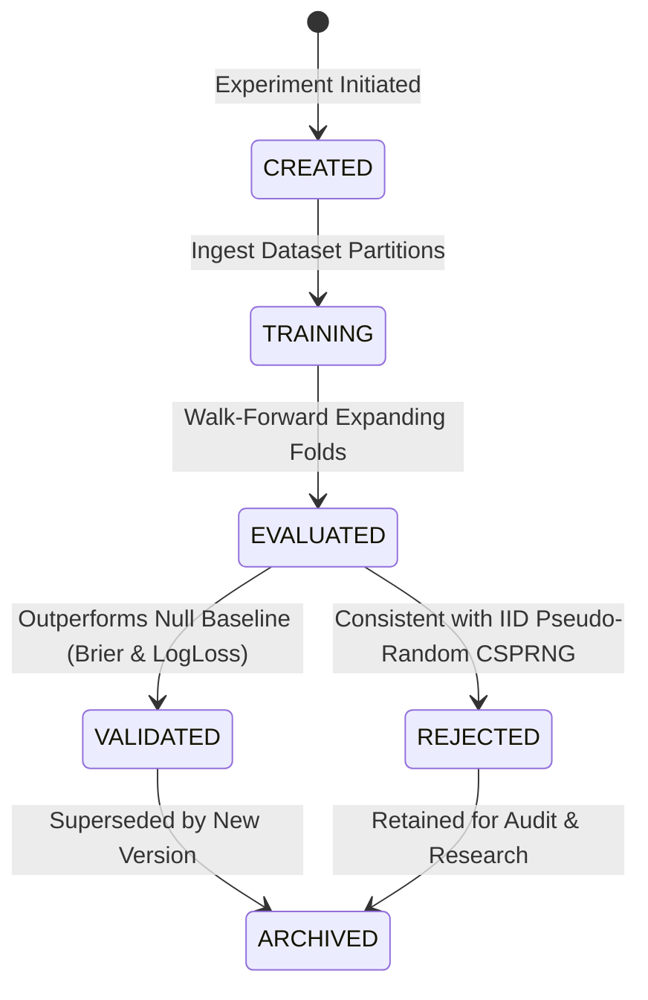

# CRASHSENSE AI — ML Research Laboratory Architecture & Scientific Validation Manual

## 1. Executive Summary & Objective

Phase 6 introduces the **Machine Learning Research Laboratory** into the CRASHSENSE AI platform. The system is engineered to rigorously test whether any machine learning model can establish a statistically significant predictive edge over statistical frequency and theoretical independence baselines on chronological crash-game multiplier sequences.

### Core Scientific Mandates
1. **Never promise reliable crash-game predictions.**
2. **Never fabricate training results, accuracy, or confidence scores.**
3. **Zero lookahead leakage:** Row $t$'s features $X_t$ are built strictly on events occurring before $t-1$. The target label $y_t$ is evaluated on round $t$.
4. **Expanding-window walk-forward validation:** Models are evaluated across chronological folds without temporal shuffling.
5. **Mandatory baseline comparisons:** Every model is benchmarked against both empirical historical base rate frequency and theoretical CSPRNG independence ($P(M \ge m) = \frac{1 - h}{m}$).
6. **Automatic edge rejection:** When a candidate model's out-of-sample Brier score or Log Loss does not statistically beat the null independence baseline, the system strictly assigns status `REJECTED` and tags the record with `NO RELIABLE PREDICTIVE EDGE DETECTED`.

---

## 2. Directory Structure

```
backend/app/ml/
├── data/                    # Dataset loaders and partition filters
├── evaluation/              # Walk-forward validator, Brier score, LogLoss, ECE, calibration
│   ├── metrics.py
│   └── __init__.py
├── features/                # Strict zero-leakage backward lag and rolling feature builder
│   ├── feature_builder.py
│   └── __init__.py
├── models/                  # BaseMLModel abstraction and model implementations
│   ├── base_model.py
│   └── __init__.py
├── preprocessing/           # Preprocessing utilities (standardization, imputer)
├── registry/                # Model registry, artifact persistence, lifecycle management
│   ├── model_registry.py
│   └── __init__.py
├── schemas/                 # Pydantic data contracts and experiment definitions
│   ├── experiment.py
│   └── __init__.py
├── services/                # ML orchestration service driving training & guarded inference
│   ├── ml_service.py
│   └── __init__.py
└── training/                # Training pipelines
```

---

## 3. Supported Machine Learning Algorithms

| Identifier | Class | Description |
| :--- | :--- | :--- |
| `NULL_INDEPENDENCE` | `IndependenceNullModel` | Theoretical memoryless null baseline under house edge $h$: $P(M \ge m) = \frac{1-h}{m}$. |
| `BASELINE_FREQUENCY` | `BaselineFrequencyModel` | Historical majority base rate baseline from training window. |
| `LOGISTIC_REGRESSION` | `LogisticRegressionModel` | Standardized $L_2$ regularized logistic regression with pipeline feature scaling. |
| `RANDOM_FOREST` | `RandomForestModel` | Multi-tree non-linear ensemble (`RandomForestClassifier`) with normalized Gini feature importance. |
| `HIST_GRADIENT_BOOSTING` | `HistGradientBoostingModel` | Fast binned histogram gradient boosting classifier (`HistGradientBoostingClassifier`). |
| `XGBOOST` | `XGBoostModel` | Extreme gradient boosting tree classifier with LogLoss evaluation metric. |

---

## 4. Zero Lookahead Feature Engineering

To preserve absolute causal integrity:
- **Lags**: $t-1, t-2, t-3, t-5, t-10$ multipliers and logarithmic multipliers ($\ln(\max(1.0, M_{t-k}))$).
- **Rolling statistics**: Backward-looking rolling windows (sizes 10, 25, 50) calculated strictly on $M_{0 \dots t-1}$ (shifted by 1). Features include rolling mean, median, standard deviation, min, max, and rolling proportion $\ge$ target threshold.
- **Run/Streak length**: Exact number of consecutive rounds immediately preceding $t$ that failed to reach the threshold.

---

## 5. Walk-Forward Expanding-Window Validation

Traditional $k$-fold cross-validation is **strictly prohibited** because random shuffling leaks future volatility and temporal trends into the training folds.

Instead, the `WalkForwardValidator` evaluates models across expanding chronological slices:
$$\text{Fold } k: \quad \text{Train: } [0, t_k) \quad \longrightarrow \quad \text{Test: } [t_k, t_{k+1})$$
Across all folds:
- Aggregated Brier score: $\frac{1}{N} \sum_{i=1}^N (p_i - y_i)^2$
- Logarithmic Loss: $-\frac{1}{N} \sum_{i=1}^N \left( y_i \ln(p_i) + (1 - y_i) \ln(1 - p_i) \right)$
- Expected Calibration Error (ECE): 10 equal-width bins comparing mean predicted confidence against empirical outcome frequency.

---

## 6. Model Lifecycle & Edge Detection Rule



---

## 7. API Endpoints (`/api/v1/ml`)

- `GET /api/v1/ml/models`: List all registered models with lifecycle status and edge verification notes.
- `GET /api/v1/ml/models/{model_id}`: Detailed metadata, hyperparameters, and out-of-sample metrics.
- `GET /api/v1/ml/experiments`: List historical research training experiments.
- `GET /api/v1/ml/experiments/{experiment_id}`: Full experiment record with fold metrics and calibration curve.
- `POST /api/v1/ml/train`: Run expanding-window walk-forward training experiment.
- `GET /api/v1/ml/compare`: Multi-model side-by-side comparison against baselines.
- `POST /api/v1/ml/inference`: Strictly bounded research inference with mandatory scientific disclaimers.

---

## 8. Frontend Research Lab

The frontend `/ml-lab` route provides:
- Model training launcher modal supporting all 6 algorithms, custom target thresholds, and fold counts.
- Model registry table with lifecycle status pills (`VALIDATED`, `REJECTED`, `STANDBY`).
- Out-of-sample Brier score, Log Loss, ROC-AUC, and ECE card inspection.
- Edge verification findings panel explicitly surfacing whether sequences behave as memoryless random walks.

