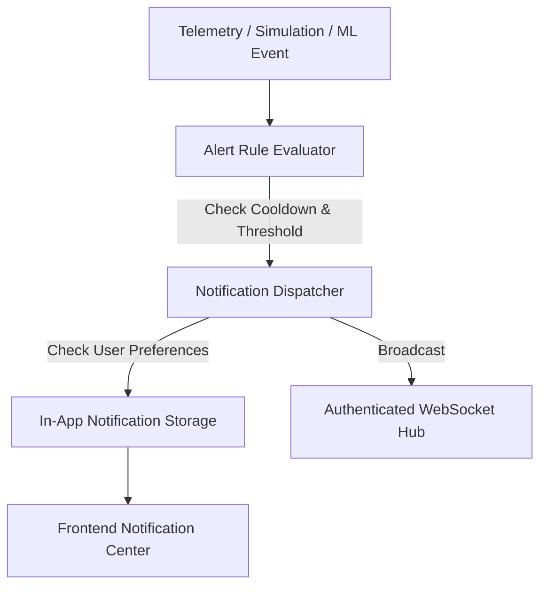

# CRASHSENSE AI — Notifications, Alerts & RBAC Architecture

## 1. Overview & Objective

Phase 9 establishes the **Centralized Notification Engine, Alert Rule Engine, and Advanced User Management with Role-Based Access Control (RBAC)** across CRASHSENSE AI.

---

## 2. Notification Engine & Preference Filtering (`backend/app/notifications/`)

1. **Notification Categories**:
   - `SYSTEM`: Infrastructure state updates and service lifecycles.
   - `SECURITY`: Access changes, role modifications, session invalidations.
   - `CONNECTOR`: Telemetry feed disconnections and reconnections.
   - `DATA_QUALITY`: Provenance warnings, duplicate bursts, and latency spikes.
   - `ML_RESEARCH`: Model walk-forward validations, rejections, and calibration notices.
   - `SIMULATION`: Backtest completions, limits reached, and simulated trade logs.
   - `RISK`: Circuit-breaker drawdown breaches and consecutive loss triggers.
   - `ACCOUNT`: User profile updates and status alterations.
   - `ADMIN`: Governance actions, user suspensions, and audit logs.
2. **Severities**: `INFO`, `SUCCESS`, `WARNING`, `ERROR`, `CRITICAL`.
3. **Preference Guardrails**:
   - Notifications are suppressed if the recipient has disabled the category or if its severity is lower than `min_severity`.
   - Real-time broadcasts are delivered through the WebSocket hub (`notification_created`).

---

## 3. Alert Rule Engine

Configurable alert rules feature cooldowns and deduplication:
- `rule_conn_disconnect`: Disconnection alert with $30\text{s}$ cooldown.
- `rule_drawdown_breach`: Drawdown circuit breaker alert ($25\%$ threshold) with $60\text{s}$ cooldown.
- `rule_model_validated`: Model edge validation notice with $300\text{s}$ cooldown.
- Simulated test firing: Safe test endpoint (`POST /api/v1/alerts/rules/{id}/test`) clearly tags dispatches with `[SIMULATED TEST]`.

---

## 4. User Management & Role-Based Access Control (RBAC) (`backend/app/users/`)

### RBAC Permission Matrix

| Role | Personal Profile & Prefs | Run Simulations | Create Alert Rules | Admin Console | Suspend Users | Inspect Audit Logs |
| :--- | :---: | :---: | :---: | :---: | :---: | :---: |
| `USER` | Yes | Yes | Yes | **No (403)** | **No (403)** | **No (403)** |
| `PREMIUM_USER` | Yes | Yes | Yes | **No (403)** | **No (403)** | **No (403)** |
| `MODERATOR` | Yes | Yes | Yes | Limited | **No (403)** | Limited |
| `ADMIN` | Yes | Yes | Yes | **Yes** | **Yes** | **Yes** |
| `SUPER_ADMIN` | Yes | Yes | Yes | **Yes** | **Yes (Full)** | **Yes (Full)** |

### Security Audit Trail
- Sensitive administrative events (`ACCOUNT_STATUS_CHANGE`, `ROLE_CHANGE`, `CIRCUIT_BREAKER_UPDATE`) are logged into the immutable security ledger with actor user ID, target resource, timestamp, outcome, and metadata.
- Passwords, access tokens, and secrets are strictly excluded from audit payloads.

