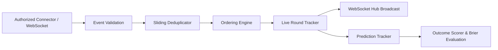

# CRASHSENSE AI — Real-Time Telemetry & Prediction Tracking Architecture

## 1. Overview & Objective

Phase 7 introduces the **Real-Time Monitoring & Prediction Tracking Engine** into CRASHSENSE AI. The system establishes an end-to-end, low-latency telemetry ingestion pipeline coupled with a strictly guarded research inference tracker and an automated outcome scoring mechanism.



---

## 2. Real-Time Ingestion Engine Components (`backend/app/realtime/`)

1. **`EventValidator` (`event_ingestion.py`)**:
   - Validates event schema, required fields (`event_id`, `event_type`, `platform_id`, `provider_id`, `game_id`, `room_id`, `source_identity`).
   - Rejects non-positive multipliers ($M < 1.00\text{x}$) or invalid timestamps.
2. **`EventDeduplicator` (`event_ingestion.py`)**:
   - In-memory compound key sliding window deduplicator ($10,000$ event buffer).
   - Key: `platform::provider::game::room::event_id`.
3. **`EventOrderingEngine` (`event_ingestion.py`)**:
   - Flags out-of-order sequence events where incoming $T_{\text{event}} < T_{\text{last\_seen}}$ for a given partition.
4. **`ConnectionManager` (`connection_manager.py`)**:
   - Tracks live connector states (`HEALTHY`, `DEGRADED`, `DISCONNECTED`, `ERROR`, `NOT_CONFIGURED`).
   - Enforces credential/authorization checks prior to socket connection.
5. **`LiveRoundTracker` (`live_round_tracker.py`)**:
   - Manages round lifecycle state machine:
     $$\text{WAITING} \longrightarrow \text{STARTED} \longrightarrow \text{ACTIVE} \longrightarrow \text{COMPLETED} \,/\, \text{FAILED}$$
   - Final multipliers are strictly recorded **after** verified outcome receipt.
6. **`PredictionTracker` (`prediction_tracker.py`)**:
   - Guarded inference: only models with `status == VALIDATED` and `has_validated_edge == True` may produce estimates.
   - All other calls return `NO_RELIABLE_PREDICTIVE_EDGE_DETECTED`.
   - Automated outcome matching: links completed round multipliers to pending research estimates and calculates individual Brier errors: $(p - y)^2$.

---

## 3. Realtime API Endpoints (`/api/v1/realtime`)

| Endpoint | Method | Description |
| :--- | :--- | :--- |
| `/api/v1/realtime/status` | `GET` | Operational telemetry summary and active connection counts. |
| `/api/v1/realtime/connections` | `GET` | Heartbeat timestamps, status, latency, and uptime across all connectors. |
| `/api/v1/realtime/connections/{id}/reconnect` | `POST` | Reconnect connector with authorization check. |
| `/api/v1/realtime/events/ingest` | `POST` | Ingest validated raw event into real-time pipeline. |
| `/api/v1/realtime/rounds` | `GET` | Query active and recently completed live crash rounds. |
| `/api/v1/realtime/rounds/{round_id}` | `GET` | Inspect specific live round record. |
| `/api/v1/realtime/estimates` | `GET` | List generated research estimates by lifecycle status. |
| `/api/v1/realtime/estimates/run` | `POST` | Trigger research estimate against active validated models. |
| `/api/v1/realtime/estimates/summary` | `GET` | Real-time Brier score, accuracy, and calibration summary. |
| `/api/v1/realtime/outcomes` | `GET` | Audit log of scored outcomes linked to research estimates. |
| `/api/v1/realtime/metrics` | `GET` | Detailed operational pipeline latency and event counters. |
| `/api/v1/realtime/health` | `GET` | Subsystem operational health status. |

---

## 4. WebSocket Streaming Protocol (`/ws/telemetry`)

Clients receive live broadcast events formatted as:
```json
{
  "event": "round_completed",
  "data": {
    "round_id": "rnd-101",
    "status": "COMPLETED",
    "actual_multiplier": 2.45,
    "event_received_timestamp": "2026-11-13T14:10:00Z",
    "verification_status": "VERIFIED"
  },
  "timestamp": "2026-11-13T14:10:00.005Z"
}
```
Available broadcast events:
- `round_started`, `round_active`, `round_completed`, `round_failed`
- `estimate_scored`
- `connector_status`

