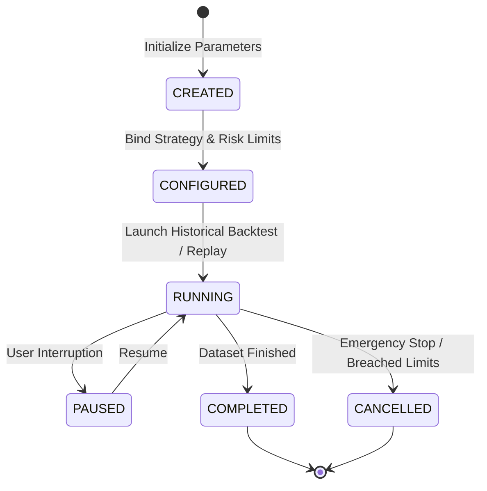

# CRASHSENSE AI — Simulation & Risk Management Architecture

## 1. Executive Summary & Core Mandate

Phase 8 implements the **Risk Management, Paper Trading & Simulation Engine** in CRASHSENSE AI. The system provides an isolated, quantitative research environment designed to simulate mathematical cashout strategies, evaluate virtual bankroll volatility, enforce institutional drawdown circuit-breakers, and perform vectorized Monte Carlo scenario analysis.

### Primary Operational Mandates
- **Pure Virtual Simulation**: Real-money betting, automated wagering, deposit/withdrawal mechanics, and headless browser betting automation are **strictly prohibited**.
- **Zero Lookahead Bias**: Decisions at simulated round $t$ are evaluated strictly prior to checking actual round $t$ outcomes.
- **Strict Loss-Chasing Prohibition**: The engine expressly rejects progressive loss-chasing (Martingale). Configurable risk limits trigger automated halts upon reaching threshold drawdowns or loss streaks.
- **Data Isolation**: Simulated records are persisted separately from genuine historical game collections.

---

## 2. Component Hierarchy (`backend/app/simulation/`)

```
backend/app/simulation/
├── bankroll_manager.py     # Virtual bankroll management, stake bounds, risk limits
├── engine.py               # Simulation execution engine & lifecycle manager
├── monte_carlo.py          # Vectorized Monte Carlo simulation & risk-of-ruin engine
├── schemas.py              # Pydantic models for simulations, trades, and risk limits
└── __init__.py
```

---

## 3. Simulation Lifecycle & Execution Modes



### Supported Modes:
1. **`HISTORICAL_BACKTEST`**: Evaluates strategies sequentially across genuine historical datasets, enforcing causal chronological ordering.
2. **`REPLAY_SIMULATION`**: Replays historical events at variable simulation speeds ($1\text{x}$ to $10\text{x}$).
3. **`LIVE_PAPER`**: Subscribes to authorized Phase 7 telemetry feeds to simulate positions in real time without placing live wagers.

---

## 4. Virtual Bankroll & Risk Limits

| Risk Control | Default | Function |
| :--- | :--- | :--- |
| `max_stake` | $\$100.00$ | Caps individual stake sizing regardless of bankroll percentage. |
| `min_stake` | $\$1.00$ | Lower bound on simulated stakes. |
| `max_drawdown_percent` | $25.0\%$ | Circuit-breaker that terminates simulation if peak drawdown is breached. |
| `max_consecutive_losses` | $5$ | Halts execution if a sequence of consecutive losses is encountered. |
| `max_simulated_rounds` | $500$ | Caps simulation duration to prevent excessive compute. |

---

## 5. Vectorized Monte Carlo Risk Engine

The Monte Carlo lab evaluates long-term bankroll survival over $N$ independent trials of $R$ rounds each:
$$P(\text{Win}) = \frac{1 - h}{M_{\text{target}}}$$
Where $h$ is operator house edge (default $1\%$) and $M_{\text{target}}$ is cashout threshold.

### Calculated Metrics:
- **Probability of Ruin ($\%$)**: Proportion of simulated paths depleting balance to $\$0.00$.
- **Drawdown Breach Risk ($\%$)**: Proportion of paths exceeding maximum acceptable drawdown.
- **Trajectory Percentiles**: $5\text{th}$, $50\text{th}$ (median), and $95\text{th}$ percentile terminal bankrolls.

